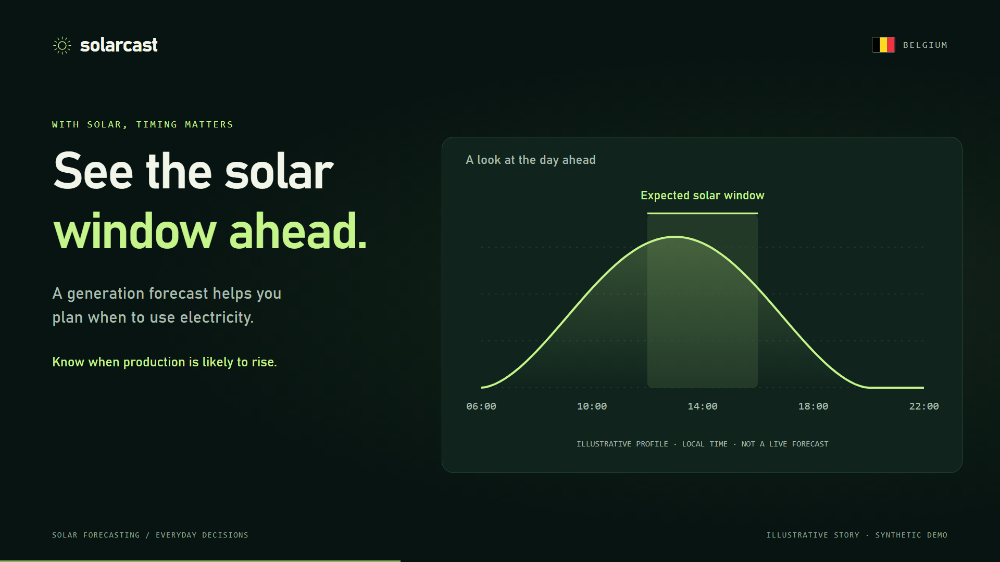
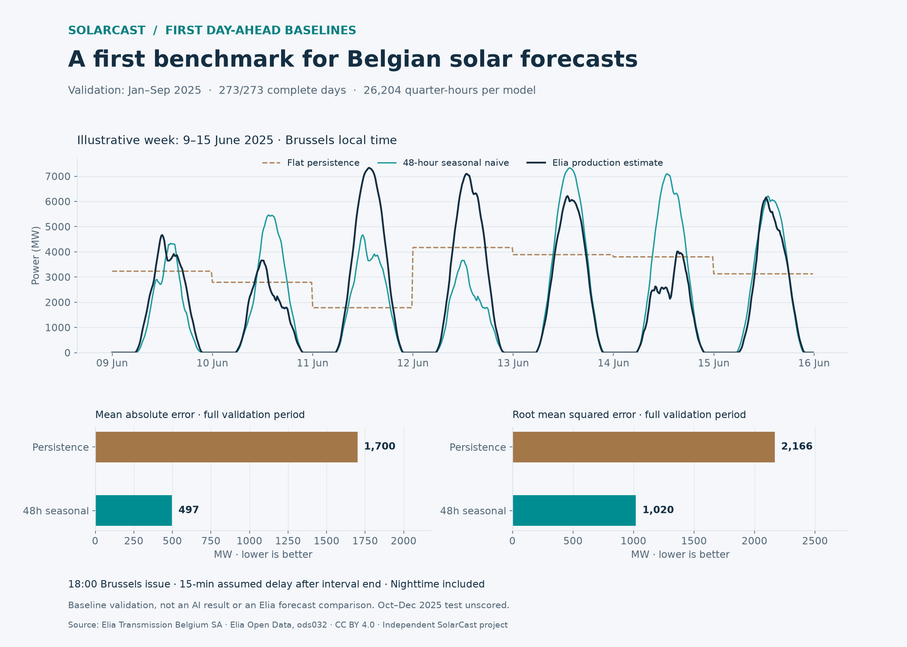

# SolarCast

**Tomorrow’s sunshine. Better decisions today.** 🇧🇪

<p align="center">
  
  
</p>

*Use more of your own solar energy. Plan flexible electricity use around the forecast. Illustrations show a planning concept; the platform demonstration uses synthetic data.*

A local solar forecasting product: upload PV production CSVs, inspect and validate them, compare models on a chronological holdout, and generate future trajectories. **Phases 1–3 are implemented: dataset inspection, historical comparison, and future forecasting.**

This application is independent of the original Belgian SolarCast research. Its forecasting engine and synthetic sample are self-contained; the original research data and trained models are not bundled. With thanks to Elia Open Data and Open-Meteo / DWD ICON for data supporting that separate research.

## Structure and stack

```text
SolarCast-BE/
├── Backend/                 # FastAPI API, forecasting engine and tests
├── Frontend/                # Next.js interface, charts and UI tests
├── Shared/
│   ├── sample_data/          # Labeled synthetic demonstration CSV
│   ├── docs/                 # Architecture and forecasting methodology
│   └── images/               # README visuals
├── README.md
└── .gitignore
```

Next.js 15 App Router, React 19, TypeScript, Tailwind 4, Recharts, and Lucide; Python 3.11+, FastAPI, Pydantic 2, pandas, scikit-learn Random Forest, XGBoost, and LightGBM. Tests use pytest/HTTPX and Vitest/Testing Library. Lockfiles record installed dependencies. Next.js 15 supports the available Node 20.17 runtime; [Next.js 16 requires Node 20.9+](https://nextjs.org/docs/app/guides/upgrading/version-16).

The browser calls same-origin `/api/*`, proxied by Next.js to loopback FastAPI. `BACKEND_URL` overrides that destination. No permissive CORS, external fonts, analytics, weather services, or cloud stores are used. Set `NEXT_TELEMETRY_DISABLED=1` to disable Next.js development/build telemetry.

## Local setup and run (PowerShell)

From the repository root, use two terminals.

Backend:

```powershell
cd Backend
python -m venv .venv
.\.venv\Scripts\python.exe -m pip install -r requirements-lock.txt
.\.venv\Scripts\python.exe -m uvicorn app.main:app --host 127.0.0.1 --port 8000
```

Alternatively install the package/test extras with `.\.venv\Scripts\python.exe -m pip install -e '.[test]'`. On macOS/Linux use `.venv/bin/python`. Run one Uvicorn worker because stores are process-local.

Frontend (Node 20.17+):

```powershell
cd Frontend
npm ci
$env:NEXT_TELEMETRY_DISABLED = '1'
npm run dev -- --turbopack
```

Open [SolarCast](http://127.0.0.1:3000), [workspace](http://127.0.0.1:3000/workspace), or [API docs](http://127.0.0.1:8000/docs). For a production frontend, stop dev, run `npm run build`, then `npm start`. Both services are required.

Development output uses `.next`; production normally uses `.next-production`. On synced Windows folders, OneDrive reparse points in old generated output can cause Next.js `readlink EINVAL` errors. Preserve that output and choose a fresh ignored relative output directory instead:

```powershell
$env:SOLARCAST_DIST_DIR = '.next-production-phase3-final'
npm run build
npm start
```

Keep the same `SOLARCAST_DIST_DIR` for `npm start`; choose another fresh `.next-production-*` name if a reused synced cache fails again. Clear the override with `Remove-Item Env:SOLARCAST_DIST_DIR -ErrorAction SilentlyContinue` before returning to default dev output. This removes the shell environment variable, not a folder.

## Sample workflow

1. Choose **Explore demo dataset** or **Load demo**.
2. Map `timestamp` and `solar_generation`; optionally map `installed_capacity`.
3. Select **Validate dataset**. Review source rows, health, and the historical chart.
4. Select a supported forecasting horizon. Both baselines always run. Select any ML models, or uncheck all for baseline-only evaluation.
5. Optionally open **Advanced settings** to choose a chronological training fraction (60–90%).
6. Select **Train & compare**. Progress is polled in the background; settings/mapping are locked during training. Cancellation acts between stages.
7. Compare actual MAE, RMSE, bias, and RMSE skill. Select a model for the holdout chart and MAE/RMSE/skill for comparison bars. Hover and drag range handles to inspect.
8. Download all historical backtest predictions as CSV, including origin, actuals, and signed errors.
9. In **Forecast what comes next**, choose any successful comparison model and a supported 15-minute/1-hour/6-hour/24-hour future window.
10. Select **Generate future forecast**. ML algorithms are refitted as one-step models on all observed history, then forecast recursively; baselines use observed history directly. Comparison scores remain unchanged.
11. Inspect the cyan dashed forecast beyond the marked data cutoff and download the distinct **future CSV**, with no invented actuals, errors, or future accuracy metrics.

The demo has 1,344 synthetic quarter-hour observations over 14 days from June 1, 2026, with explicit +02:00 offsets. It represents an imaginary 100 kW installation in kW using a daylight sine curve, periodic cloud variation, seeded random noise, and synthetic temperature. It is **not** measured Belgian/company data, real weather, or a validated PV simulator. Scores are labeled synthetic. The landing curve is independently labeled illustrative. No external dataset license is required.

## Belgian day-ahead benchmark

The real-data benchmark runs separately from the synthetic application demo. It
includes reproducible Elia downloads, observed-only eligibility, Brussels
18:00 day-ahead schedules and causal baseline validation.

- [Benchmark protocol](Shared/docs/belgian-benchmark.md)
- [Elia ingestion and reproduction](Shared/docs/elia-ingestion.md)
- [Missing-production investigation](Shared/docs/missing-production-investigation.md)
- [Training and window eligibility](Shared/docs/eligibility-policy.md)
- [Day-ahead schedules](Shared/docs/dayahead-windows.md)
- [First baseline validation results](Shared/docs/baseline-validation.md)

On January–September 2025 validation data (273 complete days), RMSE was 2,166 MW
for flat persistence and 1,020 MW for the 48-hour seasonal baseline. This is a
baseline comparison; October–December 2025 remains unscored. Full methodology,
assumptions and limitations accompany the results.



The [first frozen-ML comparison](Shared/docs/ml-validation.md) now evaluates
Random Forest, XGBoost and LightGBM on the same validation days. None beats the
48-hour seasonal baseline in this experiment; the report includes training
coverage, recursive inference, measured runtime and reproducible artifacts.

## Data contract

Use UTF-8 comma-separated `.csv`, at most 10 MB, 100,000 rows, and 100 columns, with unique nonempty headers and consistent row widths. Map distinct timestamp/generation columns explicitly. Use ISO 8601 (for example `2026-06-01T08:15:00+02:00`) and finite numeric generation in one source unit. Optional capacity must be positive/finite. Do not mix sites in a single series.

Phase 1 reports parsing, ordering, duplicates, cadence, gaps, timezone representation, missing/invalid/negative generation, and size without repairing stored source data. Naive timestamps remain unspecified; offsets are analyzed in UTC. Chart nulls do not replace original strings. Cadence is inferred; systematic missing intervals can obscure the intended frequency.

Phase 2 requires contiguous, unique, increasing timestamps, consistently aware or naive, and finite nonnegative generation no larger than 1e12. Whole-minute cadence must divide an hour, between 1 and 60 minutes. Horizons are 15 minutes, 1/6/24 hours, enabled only for integer sampling steps and enough history: one-day feature warmup, two days of usable training examples, and one day of evaluation targets after horizon purge. Correct issues at source and re-upload. Weather/capacity are not model inputs in this release.

## Backtesting methodology

See [the precise contract and equations](Shared/docs/backtesting.md). Target is one generation observation at lead time `h`, not total energy over the horizon.

At origin `o`, target is `y[o+h]`. Features use observation `y[o]`, past lags, trailing rolling statistics ending at `o`, and known target-calendar features. Training labels are strictly earlier than the first evaluation origin. No random split, centered windows, full-series fitting of transformations, holdout early stopping, or holdout tuning is used.

This is a **rolling-origin holdout with frozen fitted models**. New observations, including earlier holdout actuals, can feed later origins once available. It is not a fixed-origin multi-step forecast. Observation at an origin is assumed available immediately; telemetry delays need a future availability-lag setting.

Persistence predicts `y[o]`. Seasonal naive predicts the value 24 elapsed hours before the target, always available for these horizons; it is not DST-adjusted local-clock seasonality. ML settings are fixed and CPU-bounded with seed 42. Negative ML outputs are clipped to zero before metrics/export; source values are not clipped.

Models share identical scored rows, including nighttime zeros. Bias = prediction − actual. RMSE skill = `100 × (1 − model RMSE / persistence RMSE)`, or null when persistence error is zero. Best means lowest RMSE **on this comparison holdout**; this is not an unbiased final test score after selection. Multi-fold evaluation and an untouched final test set remain future work.

## APIs

| Method | Endpoint | Purpose |
|---|---|---|
| GET | `/api/health` | Status/phase |
| POST | `/api/datasets/upload` | Multipart CSV `file` inspection |
| POST | `/api/datasets/sample` | Load synthetic demo |
| GET | `/api/datasets/sample/download` | Sample CSV |
| GET | `/api/datasets/{dataset_id}` | Original six-row preview |
| DELETE | `/api/datasets/{dataset_id}` | Remove dataset and its jobs/results |
| POST | `/api/datasets/validate` | Validate mapping |
| POST | `/api/forecast/options` | Eligibility/horizons for dataset and split |
| POST | `/api/forecast/train` | Queue job, HTTP 202 |
| GET | `/api/forecast/status/{job_id}` | Stage/progress/friendly error |
| GET | `/api/models/results/{job_id}` | Metrics, split audit, bounded predictions |
| GET | `/api/forecast/download/{job_id}` | All historical backtest predictions |
| DELETE | `/api/forecast/jobs/{job_id}` | Cancel/remove job/results |
| POST | `/api/forecast/predict` | Queue future forecast from a successful comparison |
| GET | `/api/forecast/future/{job_id}` | Future points, observed context, and provenance |
| GET | `/api/forecast/future/{job_id}/download` | Future-only CSV |

Configuration: `dataset_id`, `timestamp_column`, `generation_column`, nullable `capacity_column`, and `train_fraction` (default .8). Training adds `horizon_minutes` (15/60/360/1440, default 60) and `models` (`random_forest`, `xgboost`, `lightgbm`; default all, empty for baselines only). Pydantic validates contracts. Pending results/download return 409; expired/absent jobs 404; duplicate active dataset jobs 409; full queue 429. Tracebacks stay server-side.

Future requests contain only `source_job_id`, a successful comparison `model`, and `horizon_minutes` (15/60/360/1440, default 1440). HTTP 202 returns a job ID with `kind: future`; reuse the status endpoint. The window must be a whole number of sampling intervals. Unexpected future-input fields are rejected. Removing a comparison also removes its dependent future jobs/results; removing only a future job leaves its source intact.

## Future forecast methodology

Origin is the uploaded dataset's final timestamp. **Future means after that cutoff, not necessarily after today.** The demo forecasts beyond its June 2026 history and is explicitly labeled as a synthetic example rather than a live forecast.

The selected ML algorithm is refitted as a one-step model on all known historical examples, including observations previously held out for comparison. Refitting targets are all observed by the cutoff. Predictions advance one interval at a time, feeding each predicted value into later lags and trailing statistics. Training/inference share `features_at_origins`. No future actuals or weather inputs are required. Original data and comparison outputs remain unchanged.

This refit recursive trajectory differs from the Phase 2 fixed-lead holdout. Its holdout scores are not future accuracy for the new strategy. Recursive errors can accumulate; no future accuracy metrics or confidence bands are supplied. Negative ML outputs are clipped to zero; unstable/non-finite outputs fail with a friendly job error. There are no physical nighttime-zero or installed-capacity constraints. Persistence holds the last observation; seasonal naive repeats the last elapsed 24 hours without local-clock DST adjustment.

The chart includes up to one day of observed context and every future point, up to 24 hours (at most 1,440 future points). CSV records the individual lead in `forecast_horizon`, full window in `forecast_window_minutes`, model, origin, method, fit strategy, generation time, and `prediction_type=future_forecast`. There are no actual/error columns. See [future forecasting details](Shared/docs/future-forecasting.md).

## Verification

```powershell
# Backend/
.\.venv\Scripts\python.exe -m pytest -q
# Frontend/
npm test
npm run typecheck
npm run build
```

Tests retain Phase 1/2 coverage and add future timestamp boundaries, recursive feedback, all-history refit alignment, real forecasting with each ML algorithm, baselines, source/backtest immutability, invalid requests, cancellation/expiry/removal, separate CSV contracts, and future UI selection/progress/retry/error states. The repository includes API and UI regression tests.

## Privacy and limits

Uploaded data is processed locally and is not intentionally sent to third parties. Dataset/job stores have one-hour logical expiry, purged on access/insertion, and clear on restart. Both job types share the limits of 10 retained jobs, four outstanding tasks, and one worker, with at most 20 datasets. Fitting uses two threads; recursive prediction uses one. Models are not persisted; each new future request refits the selected algorithm. Per-model backtest failures preserve successful comparisons; whole-job errors are friendly.

Cancellation/removal prevents result publication and deletes retained output, but cannot interrupt an estimator mid-fit. Working arrays release after that stage returns; an already-streaming download can finish. Removal is not secure memory erasure. Mapping/report/job UI state does not survive navigation or refresh; background jobs may finish and expire. Remove old comparisons/datasets to reclaim capacity. Navigating away does not cancel a job.

Historical charts show up to 2,000 consecutive rows; metrics/CSV use every evaluation target. Grouped sites, unit conversion, locale formats, automated cleaning, authentication, payments, cloud deployment, durable databases/queues, and multi-tenancy remain outside this release. Keep servers bound to loopback; no production security guarantees are made.

Next: add telemetry availability/data preparation, multiple folds and an untouched final test; evaluate the recursive strategy separately before adding calibrated uncertainty or physical constraints. Trading, batteries, and EMS stay outside scope.
