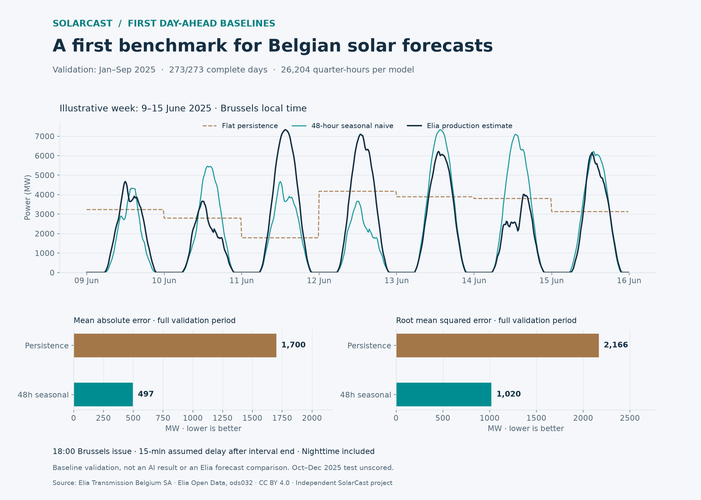

# First Belgian day-ahead baseline validation

**Commit 6. Validation delivery dates: 1 January–30 September 2025.**
These are retrospective baseline results under explicit data-availability
assumptions. They establish a reproducible starting point for later ML work.



## Predeclared methods and deadline

Both methods issue at **18:00 Europe/Brussels** for the following local day.
The extra publication delay is assumed to be **15 minutes after each 15-minute
interval completes**. The latest admissible observation therefore starts at
17:30 local time. This is a latency assumption, not a reconstructed publication log.

| Baseline | Prediction rule |
|---|---|
| `persistence` | Hold that latest admissible observation for every bridge and delivery point |
| `seasonal_naive_48h` | For each point at time `t`, use the observation at `t - 48 elapsed hours` |

The 48-hour rule was chosen before running the metrics. A simple 24-hour lag
would use observations after the 18:00 issue for some late delivery targets.
The fixed 48-hour rule avoids that problem in this scenario, but the code still
checks every chosen source's interval-end-plus-delay against issue time.

Each selected source must exist, be finite and nonnegative, and satisfy the
existing numerical bound. No substitution, interpolation, zero-filling or search
for an older valid observation occurs if the selected source is missing. Full
trajectory input eligibility is conservative: a missing bridge source invalidates
that model's entire trajectory even though these two baselines are stateless.

The seasonal rule is **elapsed UTC time**, not local-clock calendar seasonality.
Its local solar profile can shift by an hour around DST changes. No claim is
made that this is the strongest available baseline. A future local-clock baseline
needs its own explicit rules for ambiguous/nonexistent source times and latency.

Neither method is fitted or tuned. Earlier validation observations can be used
by later issue dates after they become available under the assumed delay. Inputs
are frozen at each issue: later actuals cannot update that issue's predictions.

## Common scoring set and coverage

The engine first produces each eligible baseline forecast from issue-time
history. It then evaluates reference completeness separately. A window enters
the comparison only if **both** baseline trajectories are issuable and **every**
delivery target is valid. All models receive identical issue/target pairs.
Bridge steps are retained for traceability but excluded from scoring.

| Coverage | Result |
|---|---:|
| Candidate delivery days | 273 |
| Common complete scored days | 273 |
| Excluded days | 0 |
| Scored quarter-hours per model | 26,204 |
| Day coverage | 100% |
| Issued bridge/delivery rows across both models | 66,058 |
| Scored delivery rows across both models | 52,408 |

The spring DST delivery day has 92 intervals. The 2024 missing values remain
untouched; the chosen source intervals for these validation forecasts are valid.
No October–December 2025 delivery targets are scored. The CLI explicitly rejects
evaluation ranges outside `[2025-01-01, 2025-10-01)` to protect that reserved test.
The input file contains the full study, but loading it is not final-test scoring.

## Results

Errors are pooled quarter-hour power errors in **MW**, including nighttime.
Bias is prediction minus production estimate. RMSE is computed from all point
errors, not by averaging daily RMSE values. Undefined skill at zero persistence
RMSE is represented as null.

| Baseline | MAE, MW | RMSE, MW | Bias, MW | RMSE skill vs persistence |
|---|---:|---:|---:|---:|
| Flat persistence | 1,700.10 | 2,166.30 | +515.25 | 0.00% |
| 48-hour seasonal naive | 497.07 | 1,019.70 | −9.14 | 52.93% |

The seasonal baseline reduces RMSE by **52.9% relative to flat persistence** on
this validation set. This shows the value of preserving a solar production
profile compared with holding an evening value through the next day. It does
not measure an ML improvement or improvement over Elia's published forecast.
Flat persistence is deliberately weak for a complete solar day.

The figure's line chart uses the fixed calendar week **9–15 June 2025**, selected
before inspecting performance. It is illustrative only. Its MAE/RMSE bars use
the **entire** validation period, not the illustrated week. The observed curve
is Elia's measured-and-upscaled production estimate, not a separate meter census.

## Reproduce

From `Backend` after producing the original Elia dataset:

```powershell
.\.venv\Scripts\python.exe -m app.baselines --input ../Shared/data/elia/study-2024-2025/normalized.csv --output ../Shared/data/elia/baseline-validation-v1 --availability-delay-minutes 15
```

Use a new output path if it already exists. Optional `--start`/`--end` narrow
the validation range; end is exclusive. The original CSV is never modified.

| Output | Purpose |
|---|---|
| `windows.csv` | Issue/origin, model issuance, target completeness, common-score decision and exclusion reasons |
| `predictions.csv` | All issued bridge/delivery predictions, with chosen source time and assumed source availability; no actuals |
| `scored-predictions.csv` | Common complete delivery targets with actuals, predictions and signed errors |
| `daily-metrics.csv` | Per-model daily MAE/RMSE/bias on the common set |
| `summary.json` | Full-period metrics, coverage, method definitions, explicit assumptions, source/output hashes and reserved-test guard |

Prediction keys are `(model, issue_at, target_timestamp_utc)`. Forecasts may still
be issued for a day whose future actuals are incomplete; only its scores are
excluded. When no days can be scored, metrics are null and score CSVs retain
their headers. An interrupted run remains `complete=false`.

The [archived summary](research/baseline-validation-v1/summary.json) is checked in;
large CSV artifacts remain in the ignored local data directory. The source
SHA-256 is `c82bbb0619771bc5cace5e841146950a223f1b791eecba41bd8368cd28c2d1d3`.

### Optional chart generation

Baseline evaluation adds no runtime dependency. Figure generation uses optional
Matplotlib tooling, separately pinned for the verified Python 3.12 environment:

```powershell
.\.venv\Scripts\python.exe -m pip install -r requirements-report-lock.txt
.\.venv\Scripts\python.exe research/plot_baseline_validation.py ../Shared/data/elia/baseline-validation-v1 ../Shared/images/baseline-validation-v1.png
```

Alternatively `pip install -e '.[report]'` resolves compatible chart dependencies;
the existing core dependency lock is unchanged. The plotting script verifies the
run's checksums and requires the complete preselected illustrative week.

## Verification and limitations

**161 backend tests passed**, including 17 new baseline cases. The existing
non-failing Starlette/HTTPX deprecation warning remains. The chart was rendered
and visually checked; no frontend application code changed. Small-fixture runs
also produce byte-identical artifacts and refuse to overwrite an existing run.

Independent checks reconstructed every issued prediction from its recorded
source observation, verified source availability no later than issue time,
reconstructed reference values, checked identical model scoring keys and recomputed
pooled MAE/RMSE/bias with Python `math.fsum`. Output checksums and the unchanged
source hash were verified. Tests also change all post-issue observations and
assert unchanged forecasts, check missing sources/references separately, protect
the reserved test, exercise the spring day and verify deterministic artifacts.

These are validation results on revised historical estimates with assumed latency.
There is no weather input, capacity normalization, probabilistic uncertainty,
live forecast archive, Elia forecast comparison or competition submission.
Nighttime zeros affect aggregate errors; more detailed daylight and horizon
analysis remains subsequent work. The weak reference should accompany any
public percentage-improvement claim.

The next step is to fit and evaluate existing ML models with the observed-only
training masks, the same issue deadlines, full bridge/delivery trajectories and
a comparable complete-day validation set. Keep the final test locked during that
development and model-selection process.

## Attribution

Source: Elia Transmission Belgium SA, [Elia Open Data ods032](https://opendata.elia.be/explore/dataset/ods032/),
[CC BY 4.0 / Elia licence](https://opendata.elia.be/pages/licence/).
SolarCast filters national data, normalizes timestamps and generates independent
baseline predictions and evaluation summaries. This is an independent
project; the plotted production estimate is distinct from Elia's forecast.
