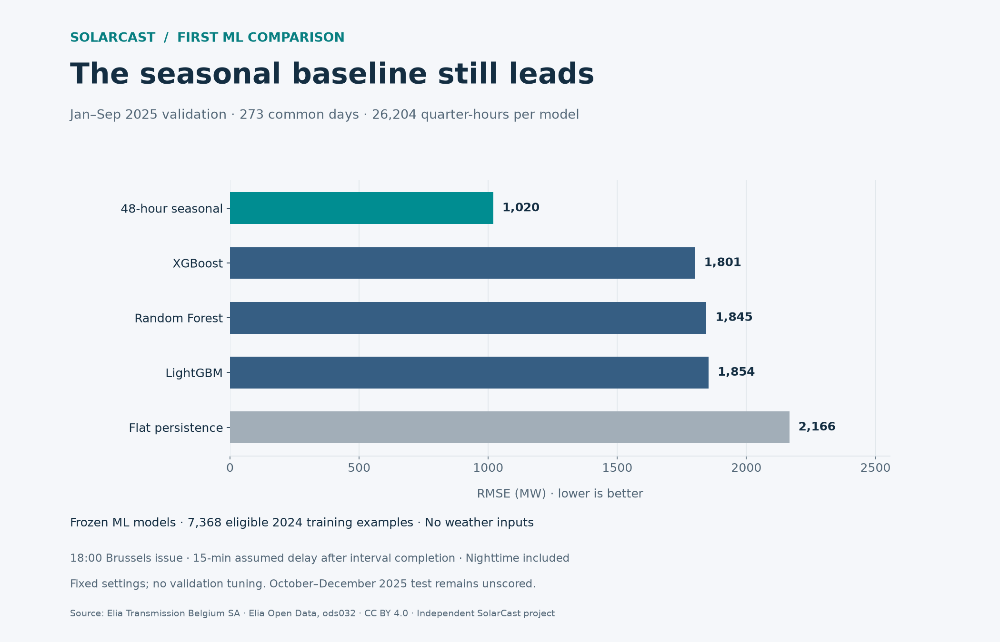

# Frozen ML day-ahead validation — commit 7

**Result: none of the three tested ML models beats the 48-hour seasonal baseline.**
All five methods are compared on the same 273 complete validation delivery days
from January–September 2025, with 26,204 quarter-hour targets per method.



## Results

Errors are pooled MW errors, including nighttime. Bias is prediction minus
Elia's measured-and-upscaled production estimate. Bridge points are not scored.

| Method | MAE, MW | RMSE, MW | Bias, MW | RMSE skill vs 48-hour seasonal |
|---|---:|---:|---:|---:|
| 48-hour seasonal | 497.07 | **1,019.70** | −9.14 | 0.00% |
| XGBoost | 1,082.99 | 1,801.16 | −622.23 | −76.64% |
| Random Forest | 1,311.12 | 1,845.21 | −144.99 | −80.96% |
| LightGBM | 1,123.14 | 1,853.76 | +544.13 | −81.79% |
| Flat persistence | 1,700.10 | 2,166.30 | +515.25 | −112.44% |

All three ML methods improve on flat persistence, but their errors remain much
higher than the seasonal reference. A claim of improvement based only on flat
persistence would conceal the stronger comparison. These findings apply to the
specific training data, feature set, fixed settings and recursive strategy below.

The baseline metrics reproduce commit 6 exactly; no scoring dates were changed.
There are 273 issued windows per method, zero excluded common windows and
131,020 scored delivery rows across all five methods. The reserved
October–December 2025 period remains unscored, with an explicit range guard.

## Training and availability

Each ML model is fitted **once** using the [observed-only training mask](eligibility-policy.md).
Training target dates lie in 2024; labels must be available under the assumed
15-minute extra publication delay by **31 December 2024, 18:00 Brussels**.
The fitting feature source is itself truncated at that cutoff before features
are calculated. No 2025 labels, preprocessing fit, validation tuning or early
stopping enter fitting.

Exactly **7,368 examples** remain eligible. Their local target-time runs are:

- 23 January 2024, 00:15–23:30: 94 examples.
- 17 October 2024, 00:15 through 31 December 2024, 17:30: 7,274 examples.

The source's missing production values remain missing. This is strongly
seasonally unbalanced training, rather than a representative full year. Its
limitations must accompany any conclusion about performance.

Fitting cutoff equals the first validation issue time. Computational training
latency at that initial gate is not simulated; these are retrospective research
results, not demonstrated operational readiness. Historical first-publication
times and revision vintages also remain assumptions.

## Features and fixed settings

Features match the existing engine: observation at origin; lags of 15 minutes,
one hour and 24 hours; trailing hour/day means and day population standard
deviation; and known target hour, weekday and day-of-year sine/cosine pairs.
Target calendar uses **UTC**, matching training and the earlier implementation.
An observation origin is an interval start, not its publication timestamp.

| Model | Fixed configuration |
|---|---|
| Random Forest | 100 trees, depth 12, minimum leaf 3 |
| XGBoost | 120 trees, depth 5, learning rate 0.05, squared error, histogram trees |
| LightGBM | 120 trees, 24 leaves, learning rate 0.05, deterministic CPU/column-wise settings |

All models use seed 42, up to two fitting threads, then one prediction thread.
Complete parameter snapshots are in the [archived summary](research/ml-validation-v1/summary.json).
The XGBoost `missing` parameter is written as the JSON-safe string `"nan"` in
that snapshot; the actual estimator uses its original default NaN setting.

No weather forecasts, capacity normalization, daylight constraints, calibration,
ensembling or parameter search were introduced. Negative ML predictions are
clipped to zero before feedback, following the existing engine. Non-finite or
out-of-range recursive predictions invalidate that model's window explicitly.

## Complete recursive forecasts

Each issue starts with its own 97 observed quarter-hours ending at the latest
admissible origin. At 18:00 Brussels with the selected delay, that observation
starts at 17:30. It is never refreshed with later actuals during that forecast.

One-step predictions feed all subsequent lag and rolling features, including
the bridge to midnight. A normal trajectory has 25 bridge and 96 delivery
points; DST days use the shared schedule's 92/100 delivery points. Every bridge
must run before the delivery predictions. Only delivery points enter metrics.

For efficiency, frozen-model predictions are batched across independent issue
dates at each recursive step. The state buffer for each date remains separate.
This does not pool observations across issues or turn later actuals into inputs.
Different DST trajectory lengths and per-window numerical failures are handled
without corrupting other states.

Baselines use their unchanged causal rules. Forecasts are generated before
checking future target completeness. A common scoring window requires all five
methods to issue successfully and every delivery reference to be valid. Missing
targets affect scoring only; they never select the generated predictions.

## Measured computation

| Method | Fit, seconds | Prediction cohort, seconds |
|---|---:|---:|
| Flat persistence | 0.00 | 2.82 |
| 48-hour seasonal | 0.00 | 2.80 |
| Random Forest | 3.12 | 4.73 |
| XGBoost | 0.85 | 1.59 |
| LightGBM | 0.25 | 1.65 |

These are measured wall times for this run, excluding loading, feature
preparation, imports and exports. ML prediction is batched across 273 issues;
the baseline path performs per-issue lookups. These timings are not a comparable
single-issue latency benchmark. Runtime varies by machine and load; it is not
part of deterministic output hashes.

## Reproduce

From `Backend`, after preparing the Elia input using the documented ingestion:

```powershell
.\.venv\Scripts\python.exe -m app.ml_validation --input ../Shared/data/elia/study-2024-2025/normalized.csv --output ../Shared/data/elia/ml-validation-v1 --availability-delay-minutes 15
```

Choose a new output directory if the run exists. The existing dependency lock
provides all model libraries. Optional `--start` and `--end` can narrow the
validation range; the command rejects dates outside January–September 2025.

| Artifact | Contents |
|---|---|
| `training-eligibility.csv` | Every 2024 candidate and its exclusion flags; identical to the earlier eligibility audit |
| `windows.csv` | Every validation day, per-model issuance and common scoring decisions |
| `predictions.csv` | All issued bridge/delivery predictions, without actuals |
| `scored-predictions.csv` | Identical complete delivery targets for every method, with actuals and errors |
| `daily-metrics.csv` | Per-model daily errors on the common set |
| `summary.json` | Aggregate results, source/output hashes, parameters, fitting cutoff, runtime and limitations |

Prediction keys are `(model, issue_at, target_timestamp_utc)`. An interrupted run
remains `complete=false`. Model fitting errors fail the run rather than silently
removing a model from the comparison. No model weights or full data exports are
committed; local artifacts are under the ignored `Shared/data/` directory.

Optional independent verification and figure generation:

```powershell
.\.venv\Scripts\python.exe research/verify_ml_validation.py ../Shared/data/elia/ml-validation-v1 ../Shared/data/elia/study-2024-2025/normalized.csv
.\.venv\Scripts\python.exe research/plot_ml_validation.py ../Shared/data/elia/ml-validation-v1 ../Shared/images/ml-validation-v1.png
```

The plotting script uses the existing optional report dependencies. The verifier
checks input/output hashes, reconstructs reference values, recomputes pooled
metrics using `math.fsum`, and checks identical scoring keys. It also refits the
same fixed settings for verification and reproduces January 1 and June 9
trajectories with the original **single-origin pandas feature implementation**,
independently of the new batched NumPy path. All six 121-point checks agreed.

## Verification and interpretation

**173 backend tests passed**, including 12 new ML-validation cases covering
feature equivalence, cutoff isolation, recursive feedback, DST lengths,
unstable-row isolation, clipping, empty cohorts, missing sources/targets, paired
scoring, the reserved-test guard and real-estimator integration. The existing
non-failing Starlette/HTTPX warning remains. No frontend code changed.

The input hash remains unchanged, and the entire training eligibility CSV
matches commit 4 byte-for-byte. Both baseline scores match commit 6. The figure
was rendered and visually checked. Runtime fields naturally differ between runs.

Seasonal training imbalance, long recursive trajectories and missing future
weather information are plausible contributors to the observed errors. This
experiment does not establish their individual causal effects. Diagnose those
factors through separately declared validation experiments before selecting
another model or changing the study design. Keep the reserved test locked.

Source: Elia Transmission Belgium SA, [Elia Open Data ods032](https://opendata.elia.be/explore/dataset/ods032/),
[CC BY 4.0 / Elia licence](https://opendata.elia.be/pages/licence/).
Independent SolarCast evaluation; no comparison with Elia's forecast is claimed.
