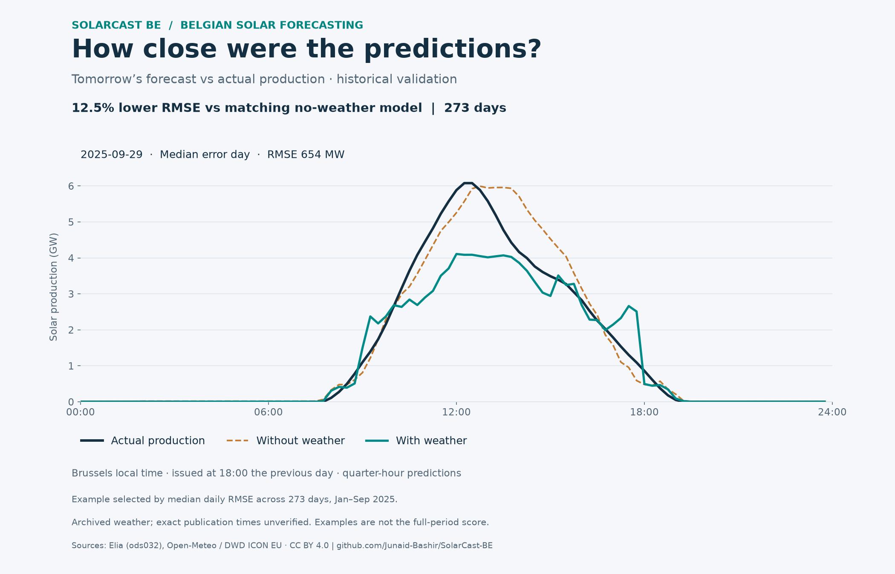
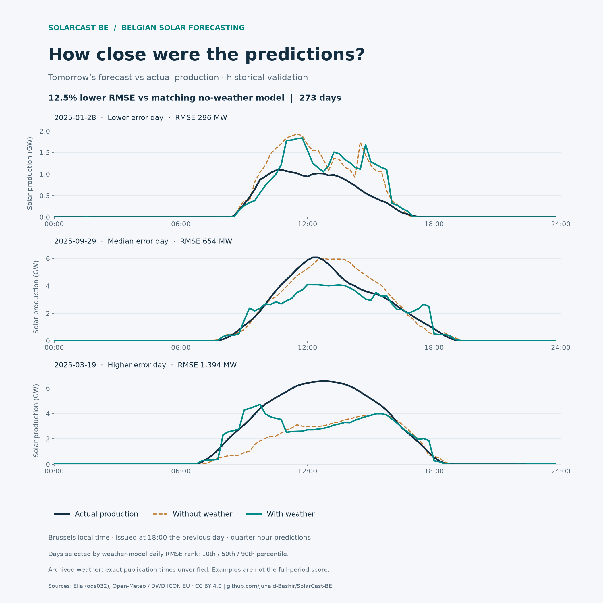

# Predictions versus actual Belgian solar production

These charts show saved **day-ahead research validation predictions**, issued
at 18:00 Brussels time the previous day. They are not live forecasts. The models
and results are unchanged from [commit 10](weather-pair.md); no fitting or tuning
was performed to create the charts.

## Main chart



The example is **29 September 2025**, the median day ranked by the weather model's
daily RMSE (rank 137 of 273). Its RMSE is 654.36 MW. The dark line is Elia reference
production, teal is the weather-aware forecast, and dashed orange is the matched
no-weather forecast. Weather does not improve every interval or every day; this
example visibly misses the midday peak.

The **12.46% reduction** in RMSE is calculated across all 26,204 validation
quarter-hours during January–September 2025, including nighttime, against the
matching no-weather model. It is not the improvement on the illustrated day.
Full-period RMSE is 876.53 MW with weather versus 1,001.31 MW without weather.

## Error range



Examples are selected automatically by weather-model daily RMSE, not by visual
appearance or improvement over the control:

| Error rank | Delivery day | Weather daily RMSE |
| --- | --- | ---: |
| 28 of 273 (near 10th percentile) | 28 January 2025 | 295.57 MW |
| 137 of 273 (median) | 29 September 2025 | 654.36 MW |
| 245 of 273 (near 90th percentile) | 19 March 2025 | 1,393.99 MW |

Sorting is ascending RMSE, then date to break ties; selected zero-based indices
are `floor(q * (N - 1))` for q = 0.1, 0.5, 0.9. These ranks are calculated in MW,
so the lower-error day does not necessarily have the lowest relative error.
Each panel has its own vertical scale. The examples do not show the full range
of possible errors and are not a measure of uncertainty.

Lines connect the original 15-minute interval-start values, converted from MW
to GW. No smoothing, resampling, missing-value filling, or artificial production
values are used. All selected days have 96 intervals. The model generates direct
quarter-hour predictions, which can produce abrupt changes; the charts preserve
those changes rather than smoothing them away.

## Reproduce

From `Backend`, with the existing commit-10 run and optional `matplotlib` plotting
dependency installed:

```powershell
python -m research.plot_weather_predictions --run ../Shared/data/weather/pair-validation-v1 --output ../Shared/images --manifest ../Shared/docs/research/weather-charts-v1/manifest.json
```

The renderer checks the prediction CSV checksum, identical model target keys,
published full-period RMSE, validation-only dates, and coverage before plotting.
The [manifest](research/weather-charts-v1/manifest.json) records source checksums,
the selection rule, dates, daily errors, and image checksums. Raw prediction CSVs
and model weights remain ignored; only the charts and compact metadata are in Git.

These results use archived Open-Meteo / DWD ICON EU weather. Exact historical
weather publication times remain unverified, and the training sample is limited
by missing production observations. See the [full limitations](weather-pair.md#limits-on-interpretation).
October–December 2025 remains unscored and is not plotted.

Sources: Elia Transmission Belgium SA, [ods032](https://opendata.elia.be/explore/dataset/ods032/),
and Open-Meteo / DWD ICON EU, CC BY 4.0. SolarCast is an independent project.
